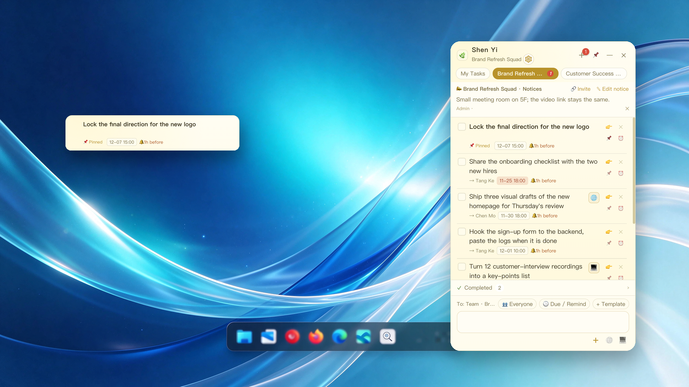
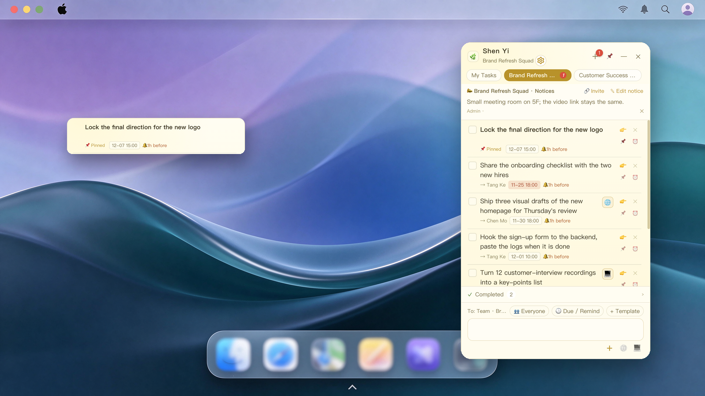
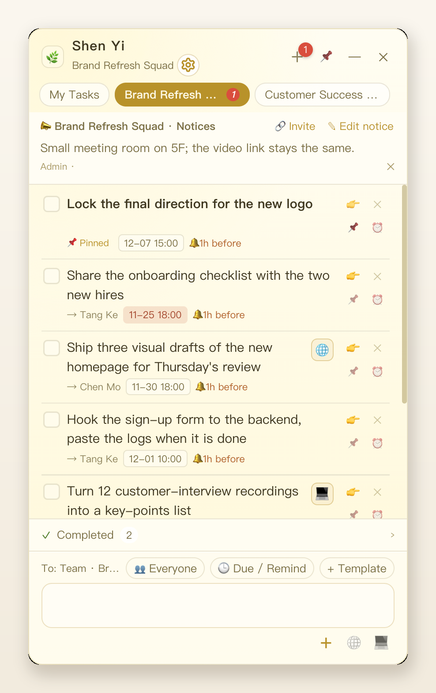

# TDLVV — To-Do List for Personal & Teamwork

A desktop task list for personal to-dos and team tasks alike. Runs on Electron, with matching code and data format on Windows and macOS.

When you stop typing for a moment, the window folds into a slim strip on your desktop; point at it and it grows back into the full list. It stays out of the way without breaking your flow.





## Features

### Teams and roles

Create a team and get a 6-character invite code; members request to join with it. The owner approves requests and assigns one of three roles — Owner, Admin, Member. When publishing a task you can target everyone, a role tag (Design / Frontend / Customer Success, …), or a few specific people.


### Invite code and device code

Invite codes expire and can be regenerated in one click. Each member also has a long-lived device code — signing in from a second computer or a phone through the link signs you in as yourself, without creating a duplicate account.


### File collaboration

A task can carry one original file. Each member who opens it gets a personal copy named `file-member.ext`, so edits never overwrite the original. When someone submits a new version, the owner or an admin confirms the replacement.


### External links

A task can point at a web link (design file, online doc) or a local path. After publishing, the globe / monitor icon on the task opens it in your browser or file manager.

### AI endpoint

The app ships a local AI service. Open **Teams & settings** to see the current base URL and access token — external tools and scripts can read and write tasks through it. If the service is still starting, it tells you to reopen settings in a moment.

### Bilingual UI

Every label in the interface has a Chinese and an English version, switchable in settings. Switching only affects the chrome — task content stays exactly as written, so members in the same team can each read it in their own language.

### Due dates and reminders

Tap the due field to pick a date and time from a calendar; lead time scrolls from 1 to 48 hours; overdue tasks turn red at a glance.


### Progress, templates, and desktop behaviour

- Task progress is averaged across the people the task is assigned to; each member advances their own percentage
- Frequently used tasks can be saved as templates and applied with one click
- Lives in the system tray / menu bar, can stay on top, can start at login
- Data is stored as local JSON with a backup written before exit



## Download

See the **Releases** page for `v0.6.3`:

| Platform | File | Notes |
| --- | --- | --- |
| Windows | `TDLVV-Setup-v0.6.3.exe` | Installer (NSIS, x64), custom install folder |
| Windows | `TDLVV-win-x64.zip` | Portable build, unzip and run `win-unpacked/TDLVV.exe` |
| macOS | `TDLVV-mac-arm64.dmg` | Installer (Apple Silicon) |
| macOS | `TDLVV-mac-arm64.zip` | App archive, unpack and run `TDLVV.app` |

> The builds are 78MB / 110MB / 138MB / 132MB, beyond GitHub's 100MB per-file limit for repositories, so they live as release assets instead of in the tree.

## Repository layout

```
TDLVV/
├─ pc/               Windows project
│  ├─ src/           main process + renderer
│  ├─ test/          Node tests
│  ├─ build/         icons (icon.ico app/installer, icon.png tray)
│  └─ package.json
└─ mac/              macOS project
   ├─ src/
   ├─ test/
   ├─ build/         icons (icon-mac-1024.png app, icon.png tray)
   └─ package.json
```

`src` and `test` are identical across both platforms; platform differences live in each `package.json` build config.

## Run locally (no packaging)

```powershell
# Windows
cd pc
npm install
npm start
```

```bash
# macOS
cd mac
npm install
npx electron .
```

The first launch shows the main window; later launches only leave the background process and a tray icon — click "Open note" in the tray menu to get back.

## Build

```powershell
# Windows installer
cd pc
npm run dist:win          # dist\TDLVV-Setup-v<version>.exe
```

```bash
# macOS (Apple Silicon)
cd mac
npx electron-builder --mac --arm64    # dist/TDLVV-mac-arm64.dmg + .zip
```

Packaging on macOS needs `bin/cloudflared-mac-arm64` and `bin/cloudflared-mac-x64` (the cloudflared binaries used for tunnelling). Each is about 40MB and is not in the repository — download them from Cloudflare and drop them into `mac/bin/` under those names.

## Tests

```bash
cd pc
node test/sync.test.js
node test/features.test.js
node test/files-copy.test.js
node test/filepaths.test.js
node test/persist.test.js
node test/transfer.test.js
```

## Stack

- Runs on Electron 33
- Plain HTML/CSS/JS renderer, no framework
- Local JSON storage (Windows: `%APPDATA%\TDLVV`, macOS: `~/Library/Application Support/TDLVV`)
- Team sync: the host machine runs an HTTP service; members reach it over LAN or a cloudflared tunnel

## License

MIT
