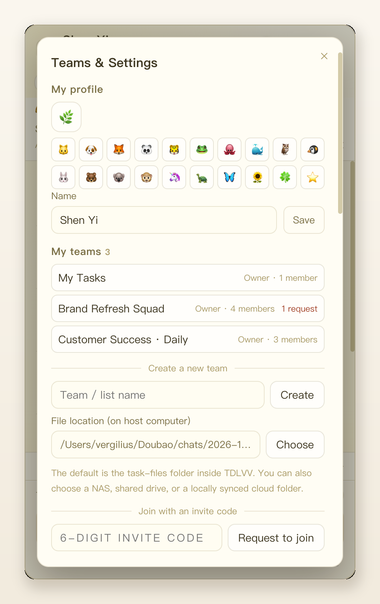
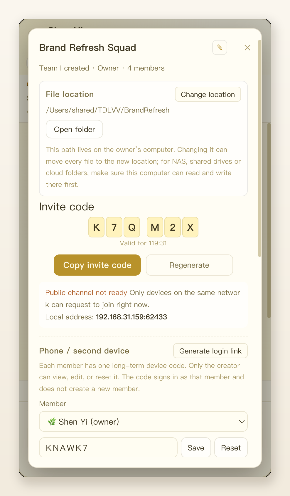
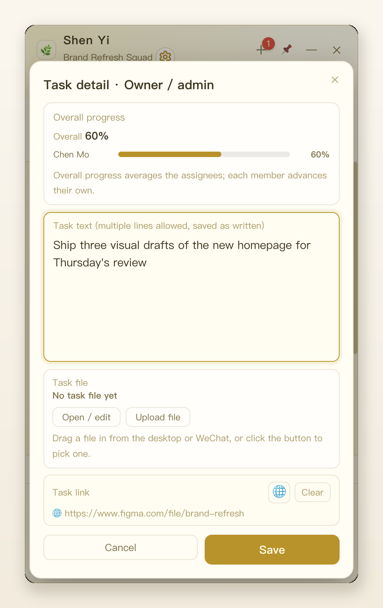
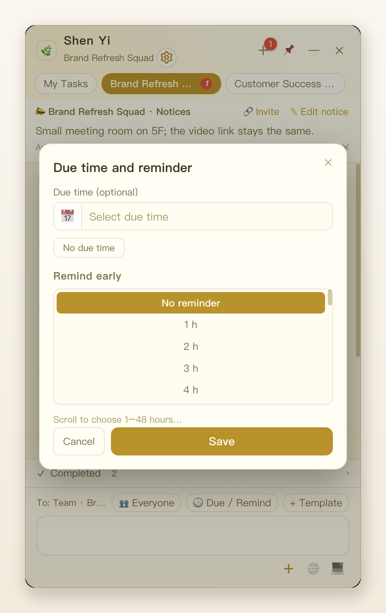

# TDLVV — Desktop To-Do List for Personal & Teamwork

[中文说明 →](README.md) · Current version **v0.6.13** · [Download the latest release](https://github.com/Vergilius-111/TDLVV/releases/latest)

TDLVV is a task list that lives on your desktop: personal to-dos and team tasks in one window. Built on Electron, Windows and macOS share the same source code and data format.

Move the pointer away for 3 seconds and the window folds into a slim strip on your desktop — up to 5 to-dos, one line each. Point at it again and it grows back into the full list. It stays out of the way without breaking your flow.


## Download and install

Get the build from the [latest release](https://github.com/Vergilius-111/TDLVV/releases/latest). v0.6.13 ships two assets:

| Platform | File | Notes |
| --- | --- | --- |
| Windows | `TDLVV-Setup-v0.6.13.exe` | NSIS installer (x64), custom install folder, launches and shows the main window when setup finishes |
| macOS | `TDLVV-mac-universal-v0.6.13.zip` | Universal archive containing `TDLVV-arm64.app` (Apple Silicon) and `TDLVV-x64.app` (Intel); drag the one matching your chip into Applications |

> The builds are roughly 96 MB / 248 MB, beyond GitHub's 100 MB per-file limit for repositories, so they live as release assets rather than in the tree.
>
> The macOS app is unsigned. If the first launch says the developer cannot be verified, right-click the app in Finder and choose **Open**, or allow it under **System Settings → Privacy & Security**.
>
> Updates are built in: while running, the app checks GitHub Releases every 30 minutes, and you can check manually in settings. Downloads happen in the background and install directly — no browser page is opened.

A fresh install or an upgrade shows the main window on first launch so you can get started right away. After that, launching the app only leaves a background process and a tray icon; use the tray menu to bring the window back.

## Getting started

1. Enter a name on first launch — you get a local list called "My tasks"
2. **Create a team** in Teams & settings to get a 6-character invite code, or **join one** by entering someone else's code and waiting for the owner to approve
3. Type a task in the box at the bottom and press `Enter` to publish. Pick everyone, a role tag, or select specific members


## Features

### Teams and members

The owner approves join requests and assigns one of three roles — Owner, Admin, Member — plus role tags (Design, Frontend, Customer Success, …). Tasks can be published to a role tag or to several selected members. Each member marks their own completion separately, and the owner sees a summary such as "3 done · 2 open". Presence is based on a heartbeat within the last 45 seconds.

Invite codes are 6 characters and rotate every 10 minutes. Joined members identify the team by a stable 8-character `boardId`, so rotation does not break their connection. Each installation has a `clientId`, so leaving and rejoining does not create a duplicate "ghost" member with the same name.



### Three kinds of device codes

| Code | Purpose | Permission |
| --- | --- | --- |
| Home device code | One code aggregating all your personal tasks and every team you are in, opened on a phone or a second computer | Acts as you: can publish, mark done, browse everything |
| Member code | Sign in as a specific member on another device; long-lived | Same identity as that member — no duplicate account is created |
| Viewer code | For people who only need to follow progress | Read-only: sees all tasks and files, cannot publish or modify |

Codes are generated on the desktop app; open the link in a phone browser. The mobile pages and the desktop app share the same data.



### File collaboration

A task can carry one original file. Each member who opens it gets a personal copy named `file-member.ext`, so edits never overwrite the original. When someone submits a new version, the owner or an admin confirms the replacement. The task folder defaults to `task-files` inside the install directory, and can be pointed at a NAS, a shared drive, or a synced cloud folder.



### Due dates, reminders and templates

Tap the due field to pick a date and time from a calendar; lead time scrolls from 1 to 48 hours; overdue tasks turn red. Frequently used tasks can be saved as templates (up to 5) and applied with one click. New tasks raise a system notification listing up to 4 items plus "N more".



### External links

A task can point at a web link (design file, online doc) or a local path. After publishing, the globe / monitor icon on the task opens it in your browser or file manager.

### AI endpoint and summaries

The app includes a read-only AI endpoint bound to `127.0.0.1` on a randomly assigned port. Its address and access token are written to `ai-bridge.json` in the app data directory and shown in Teams & settings. External tools and scripts can use it to read tasks, template fields and status for consolidation and analysis.

Owners and admins can also request an **AI summary** for a team task: the original file plus every member's copy are packaged into a request that an AI tool such as WorkBuddy turns into `<task>-member-summary.xlsx`. The tool is opened in the previous conversation session when one exists.

### Appearance and desktop behaviour

- Mini strip: up to 5 to-dos, one line each; folds away after 3 seconds with the pointer outside
- Dark / light / follow-system themes, three font sizes, rounded frameless window
- Lives in the system tray / menu bar, can stay on top, can start at login
- Task list, team notices, completed items and member management all switch within the same window
- `Enter` publishes, `Shift+Enter` / `Ctrl+Enter` inserts a line break; while editing, `Ctrl+Enter` saves and `Esc` cancels

### Bilingual UI

Every label has a Chinese and an English version, switchable in settings. Switching only affects the interface — task content stays exactly as written, so members of the same team can each read it in their own language.


## Connectivity (read this before debugging)

The owner's machine runs an HTTP service on a random port; members pull incremental state every 1.5 seconds. The address is resolved in this order:

1. **A manually entered address** (a link or LAN IP from the owner)
2. **Direct LAN connection** — UDP broadcast discovery on port 41234, used only after a live probe succeeds
3. **Public relay fallback** — look up the owner's current public address in the address book

Beacons carry a stable 8-character `boardId`, so members can find the host again after an invite code rotates or the tunnel gets a new hostname. The public address comes from a bundled cloudflared quick tunnel, published to a self-hosted relay with a second copy on ntfy.sh as fallback; clients try the relay first, then ntfy. **The address book only stores "team → current address" and never forwards task content.**

### Why is "Teams on this network" empty?

This is usually the network, not the app:

- **Different subnets / VLANs** — corporate networks commonly split wired and wireless into separate subnets. UDP broadcasts do not cross gateways, so an empty list is expected
- **Firewall** — Windows blocks inbound UDP 41234 broadcasts by default when the network profile is Public
- **AP isolation** — some routers and enterprise WiFi networks prevent wireless clients from seeing each other

A LAN connection is not required: share the invite code and the other person joins over the public relay instead. For LAN discovery to work, both devices must be on the same subnet, able to ping each other, and UDP 41234 must be allowed. You can also host your own address book: run `node pc/src/relay-server.js` on a server with a public IP (port 8787 by default, override with `PORT`), put HTTPS in front of it, and enter your relay URL in settings.

## Data and backups

- Local JSON storage: `%APPDATA%\TDLVV` on Windows, `~/Library/Application Support/TDLVV` on macOS
- Atomic writes (temp file + fsync + rename), a backup before exit, and the last 7 days of backups kept
- Backup export / import, with a safety backup taken before any import
- Task files are stored separately from the JSON data, so the file root can be moved to a shared drive

## Repository layout

```
TDLVV/
├─ pc/                  Windows project
│  ├─ src/              main process, renderer, mobile / home web pages
│  │  └─ renderer/       UI (plain HTML/CSS/JS)
│  ├─ test/              Node tests
│  ├─ bin/              cloudflared.exe, rcedit, WorkBuddy send script
│  ├─ build/             icons
│  └─ package.json
├─ mac/                 macOS project
│  ├─ bin/              cloudflared arm64 / x64 binaries
│  └─ ...               src/ and test/ are identical to pc/
├─ docs/screenshots/    documentation screenshots
├─ build-release.cmd    one-shot release packaging script (6 steps)
├─ README.md            Chinese readme
└─ README.en.md         this file
```

`pc/src` matches `mac/src` and `pc/test` matches `mac/test` exactly; platform differences live only in each `package.json` build config. Edit `pc/src` first, then sync to `mac/src`.

## Run locally (no packaging)

```powershell
# Windows
cd pc
npm install
npm start
```

```bash
# macOS
cd mac
npm install
npm start
```

A normal launch only leaves the tray icon. To force the window to appear, use `npm run dev` on Windows or `npx electron . --show-window` on macOS (or set `TDLVV_SHOW_WINDOW=1`).

## Build

```powershell
# Windows installer (output: pc/dist/TDLVV-Setup-v<version>.exe)
cd pc
npm run dist:win
```

```bash
# macOS universal build (output: mac/dist/, must run on a Mac)
cd mac
npm run dist:mac
```

`build-release.cmd` in the repository root is the maintainer's one-shot release script: it syncs `pc/src → mac/src`, builds the Windows installer, generates a version-stamped `app.asar`, replaces both `app.asar` files inside an existing complete mac archive (preserving symlinks) to produce the universal zip, then copies the exe and zip to the downloads folder. `ROOT` and `DL` in the script are maintainer-local paths — change them to your own before use, and keep `VER` in sync with the `version` in `pc/package.json`.

macOS builds need `mac/bin/cloudflared-mac-arm64` and `mac/bin/cloudflared-mac-x64` (~40 MB each, included in the repo); Windows uses `pc/bin/cloudflared.exe`.

## Tests

```powershell
# Windows (PowerShell)
Get-ChildItem pc/test/*.test.js | ForEach-Object { node $_.FullName }
```

```bash
# macOS / Git Bash
for f in pc/test/*.test.js; do node "$f"; done
```

Covers sync, member file copies, paths, persistence, import/export, invite code rotation, LAN-first resolution, reconnection, identity reuse, device codes and viewer permissions, update checks and startup behaviour. The `tunnel` / `discover` cases need public network access and may fail on restricted networks.

## Stack

- Electron 33 + electron-builder 25, no runtime dependencies
- Plain HTML/CSS/JS renderer with no framework; `contextIsolation: true` and `nodeIntegration: false`, with a restricted API exposed via preload
- Local JSON storage with atomic writes and automatic backups
- Team sync: host HTTP service with `since=rev` incremental pulls; LAN UDP discovery + cloudflared tunnel + address book relay
- Content Security Policy: `default-src 'self'`

## License

MIT
