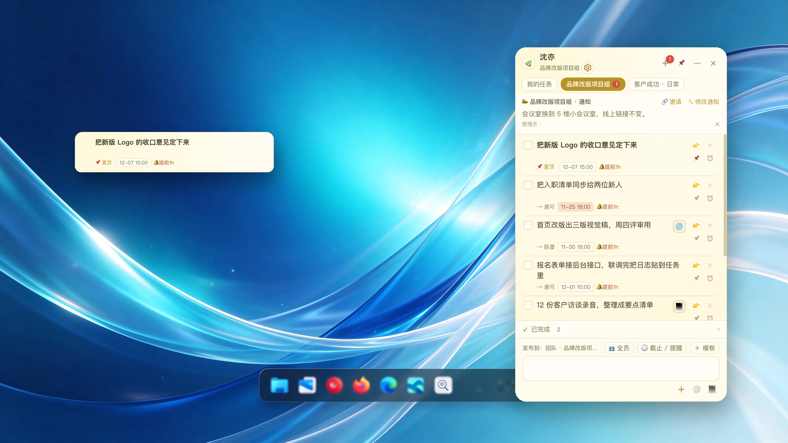
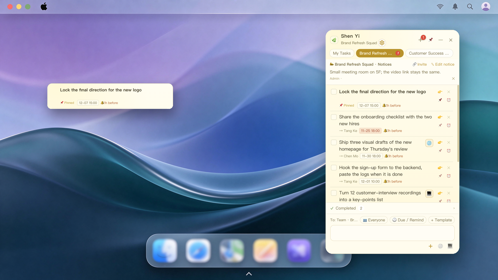
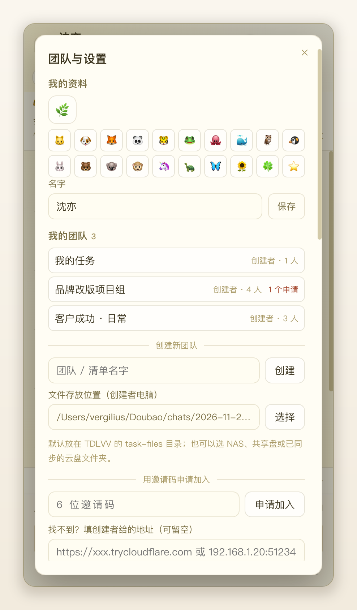
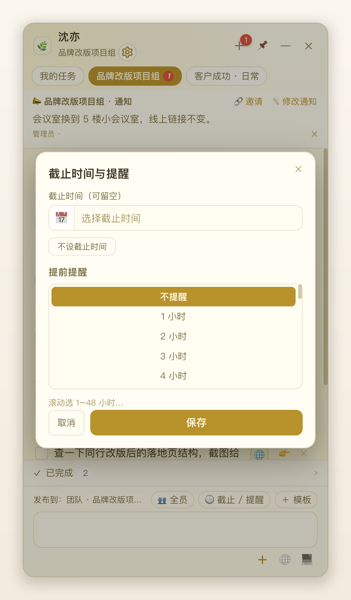

# TDLVV — 桌面任务清单（个人 / 团队）

[English README →](README.en.md) · 当前版本 **v0.6.13** · [下载最新版](https://github.com/Vergilius-111/TDLVV/releases/latest)

TDLVV 是一款常驻桌面的任务清单：个人待办和团队事项，都在同一个窗口里管。基于 Electron，Windows 与 macOS 共用一套源码与数据格式。

鼠标离开 3 秒，窗口自动收成桌面上的一条细横条——最多 5 条待办、每条一行；移回去又长回完整清单。不挡路，也不打断思路。





## 下载与安装

到 [Releases 最新版](https://github.com/Vergilius-111/TDLVV/releases/latest) 下载，当前 v0.6.13 提供两个附件：

| 平台 | 文件 | 说明 |
| --- | --- | --- |
| Windows | `TDLVV-Setup-v0.6.13.exe` | NSIS 安装包（x64），可自选安装目录，装完自动启动并弹出主界面 |
| macOS | `TDLVV-mac-universal-v0.6.13.zip` | 通用包，内含 `TDLVV-arm64.app`（Apple Silicon）与 `TDLVV-x64.app`（Intel），把对应芯片那个拖进「应用程序」即可 |

> 安装包约 96 MB / 248 MB，超过 GitHub 仓库单文件 100 MB 限制，因此只放在 Releases 附件里，不进代码库。
>
> macOS 应用未签名。首次打开若提示「无法验证开发者」，在 Finder 里右键应用 →「打开」，或到「系统设置 → 隐私与安全性」允许。
>
> 应用内置更新检查：常驻时每 30 分钟复查一次 GitHub Releases，也可在设置里手动检查；下载在后台进行，完成后直接安装，不会跳转网页。

首次安装或升级后的第一次启动会主动弹出主界面，方便立刻上手；之后的日常启动只留后台进程 + 托盘图标，点托盘菜单即可回到界面。

## 快速上手

1. 首次启动填个名字，得到一份「我的任务」本地清单
2. **建团队**：在「团队与设置」里新建团队，拿到 6 位邀请码；**加入团队**：填对方的邀请码申请，创建者同意后入队
3. 在底部输入框写一条，`Enter` 发布；发布范围可选全员、角色标签，或勾选指定成员


## 功能

### 团队与成员

创建者审批入队申请，可给成员设「创建者 / 管理员 / 成员」三种身份和角色标签（设计、前端、客户成功…）。发布任务时按角色标签或勾选多位成员指派；每位成员可单独勾选自己的完成状态，创建者能看到「已完成 3 人 · 未完成 2 人」这样的汇总。成员在线状态依据 45 秒内的心跳判定。

邀请码 6 位、每 10 分钟自动轮换；已加入的成员用 8 位稳定 `boardId` 识别团队，换码不影响连接。成员身份由安装标识 `clientId` 固定，退出后重新加入不会多出一个重复的人名。



### 三种设备码

| 码 | 用途 | 权限 |
| --- | --- | --- |
| 主页设备码 | 一个码聚合「我」的全部个人任务和所有团队，在手机或第二台电脑上打开 | 以本人身份操作，可发布、勾选完成 |
| 成员码 | 在另一台设备上以某个成员身份登录，长期有效 | 等同该成员本人，不会凭空创建新账号 |
| 查看者码 | 给只想看进度的人使用 | 只读：能看全部任务与文件，不能发布或修改 |

设备码在电脑上生成，链接发出去后手机浏览器直接打开；手机端页面和电脑端共用同一份数据。


### 文件协作

一条任务可以挂一个原文件。成员打开时各自生成 `文件名-成员名.后缀` 的个人副本，怎么改都不会覆盖创建者的原文件；成员提交新版本后，由创建者或管理员确认才替换。任务文件夹默认在安装目录的 `task-files` 下，也可以改到 NAS、共享盘或已同步的云盘目录。


### 截止、提醒与模板

点一下截止时间即可在日历里选日期和时间；提前提醒支持 1–48 小时；逾期任务标红。常用任务可存成模板（最多 5 个），发布时一键套用字段。新任务会以系统通知提示，最多列出 4 条再汇总「还有 N 个」。



### 外部链接

任务可挂一个网页链接（设计稿、在线文档）或本机路径。发布后点任务上的地球 / 电脑图标，直接用系统浏览器或文件管理器打开。

### AI 接口与汇总

软件内置一个只监听本机 `127.0.0.1` 的只读 AI 接口，端口随机分配，地址和访问令牌写在应用数据目录的 `ai-bridge.json`，在「团队与设置」里也能直接看到。外部工具或脚本可用它读取任务、模板字段与状态，做文件整合、数据分析。

创建者/管理员还能对一条团队任务发起「AI 汇总」：把创建者原稿和成员副本一起打包成请求，交给 WorkBuddy 等 AI 工具生成 `<任务>-成员汇总.xlsx`。唤起时优先复用上次的对话会话。

### 外观与桌面形态

- 迷你条最多 5 条、每条一行；鼠标离开满 3 秒自动收起
- 深色 / 浅色 / 跟随系统三档主题，小 / 中 / 大三档字号，圆角无边框窗口
- 常驻系统托盘 / 菜单栏，可置顶、可随系统开机自启
- 任务清单、团队通知、已完成列表、成员管理都在同一窗口内切换
- `Enter` 发布、`Shift+Enter` / `Ctrl+Enter` 换行，编辑时 `Ctrl+Enter` 保存、`Esc` 取消

### 中英双语

界面文案全量中英双语，设置里一键切换；切换只影响界面，任务内容保持原样——团队里不同语言的成员可以各看各的。


## 连接与同步（重要）

创建者机器起一个随机端口的 HTTP 服务，成员端每 1.5 秒增量拉取一次状态。地址按以下顺序解析：

1. **手填地址**（创建者给的链接或局域网 IP）
2. **局域网直连**：UDP 41234 广播发现，探活通过才使用
3. **公网中继兜底**：从地址簿查出创建者当前的公网地址

广播包带 8 位稳定 `boardId`，因此邀请码轮换、隧道换域名后，已加入的成员仍能找回主机。公网地址由创建者用内置 cloudflared 快速隧道生成，发布到自建 relay，同时写一份到 ntfy.sh 作为回退；成员端先查 relay，失败再查 ntfy。**地址簿只存「团队 → 当前地址」，不转发任何任务内容。**

### 「同一网络里的团队」扫不到人？

这是常见问题，原因通常在公司网络，而不是软件：

- **不同网段 / VLAN**：无线和有线常被划到不同网段。UDP 广播不跨网关，此时列表为空是正常现象
- **防火墙**：网络类型为「公用网络」时，Windows 默认拦掉 UDP 41234 的入站广播
- **AP 隔离**：部分路由器 / 企业 WiFi 开启客户端隔离，同网段设备之间也互相看不见

本软件不需要局域网也能用：把邀请码发给对方走公网通道即可加入。想让局域网直连生效，需要两台设备在同一网段且能互相 ping 通，并放行 UDP 41234。可选部署自己的地址簿中继：在有公网 IP 的服务器上运行 `node pc/src/relay-server.js`（默认 8787，可用 `PORT` 环境变量改），建议前面挂 HTTPS，然后在设置里填入你的中继地址。

## 数据与备份

- 数据存本地 JSON：Windows `%APPDATA%\TDLVV`，macOS `~/Library/Application Support/TDLVV`
- 写入采用「临时文件 + fsync + 重命名」的原子方式，退出前自动备份，保留最近 7 天
- 支持导出 / 导入备份，导入前会再生成一份安全备份
- 任务文件与 JSON 数据分开存放，方便把文件目录指到共享盘

## 目录结构

```
TDLVV/
├─ pc/                  Windows 工程
│  ├─ src/              主进程、渲染进程、手机/主页网页端
│  │  └─ renderer/      界面（原生 HTML/CSS/JS）
│  ├─ test/              Node 测试
│  ├─ bin/              cloudflared.exe、rcedit、WorkBuddy 发送脚本
│  ├─ build/            图标
│  └─ package.json
├─ mac/                 macOS 工程
│  ├─ bin/              cloudflared 的 arm64 / x64 二进制
│  └─ ...               src/、test/ 与 pc 完全一致
├─ docs/screenshots/    文档截图
├─ build-release.cmd    一键发布打包脚本（6 步）
├─ README.md            中文说明
└─ README.en.md        英文说明
```

`pc/src` 与 `mac/src`、`pc/test` 与 `mac/test` 保持完全一致，平台差异只在各自 `package.json` 的 `build` 配置里。改代码时改 `pc/src`，再同步到 `mac/src`。

## 本地跑起来（免打包）

```powershell
# Windows
cd pc
npm install
npm start
```

```bash
# macOS
cd mac
npm install
npm start
```

日常启动默认只留托盘；需要强制显示窗口时，Windows 可用 `npm run dev`，macOS 可用 `npx electron . --show-window`（或设置环境变量 `TDLVV_SHOW_WINDOW=1`）。

## 打包

```powershell
# Windows 安装包（产物 pc/dist/TDLVV-Setup-v<version>.exe）
cd pc
npm run dist:win
```

```bash
# macOS 通用包（产物 mac/dist/，需在 Mac 上运行）
cd mac
npm run dist:mac
```

仓库根目录的 `build-release.cmd` 是维护者用的一键发布脚本：同步 `pc/src → mac/src`、打 Windows 安装包、生成含版本号的 `app.asar`、基于已有完整 mac 包替换两份 `app.asar`（保留符号链接）生成 universal zip，最后把 exe 和 zip 复制到下载目录。脚本里的 `ROOT` / `DL` 是维护者本机路径，其他人使用前请先改成自己的路径，并把 `VER` 与 `pc/package.json` 的 `version` 同步。

macOS 打包需要 `mac/bin/cloudflared-mac-arm64` 与 `mac/bin/cloudflared-mac-x64`（各约 40 MB，已入库）；Windows 对应的是 `pc/bin/cloudflared.exe`。

## 测试

```powershell
# Windows（PowerShell）
Get-ChildItem pc/test/*.test.js | ForEach-Object { node $_.FullName }
```

```bash
# macOS / Git Bash
for f in pc/test/*.test.js; do node "$f"; done
```

覆盖同步、文件副本、路径、持久化、导入导出、邀请码轮换、局域网优先、断线重连、身份复用、设备码与查看者权限、更新检查、启动行为等。其中 `tunnel` / `discover` 相关用例依赖公网连通性，在网络受限环境下可能失败。

## 技术栈

- Electron 33 + electron-builder 25，无运行时依赖
- 渲染层为原生 HTML/CSS/JS，无框架；`contextIsolation: true` + `nodeIntegration: false`，通过 preload 暴露受限 API
- 本地 JSON 存储，原子写入 + 自动备份
- 团队同步：创建者 HTTP 服务 + `since=rev` 增量拉取；局域网 UDP 广播发现 + cloudflared 隧道 + 地址簿中继
- 内容安全策略 `default-src 'self'`

## 许可证

MIT
