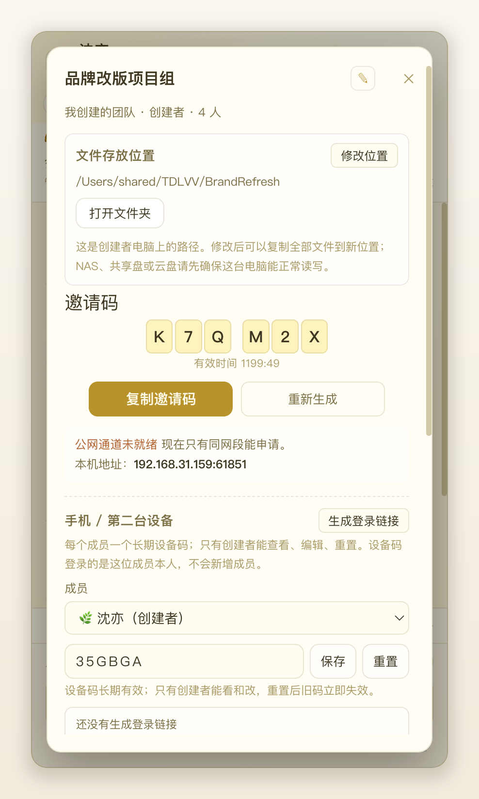
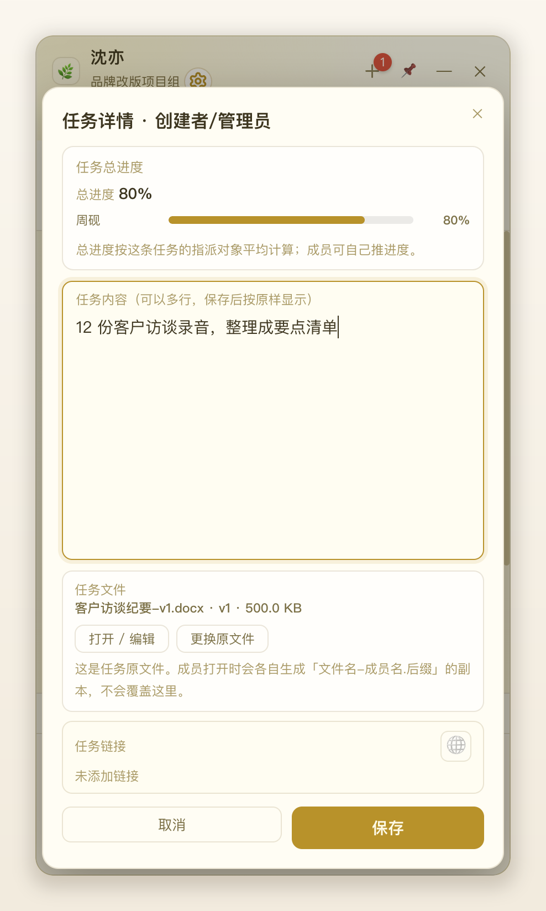
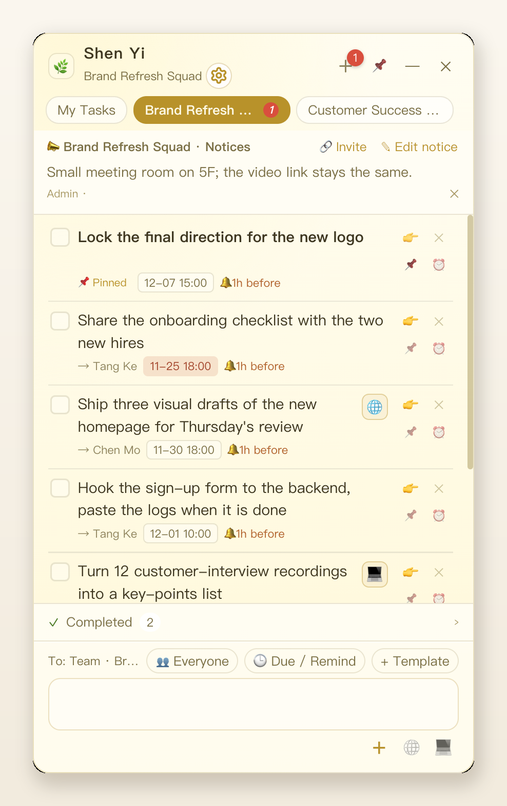
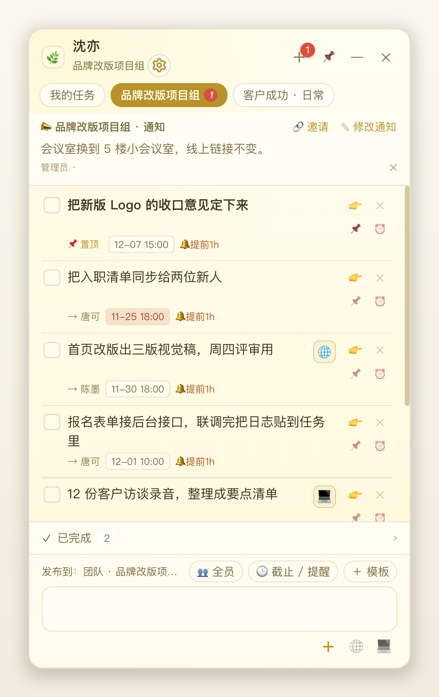

# TDLVV — To-Do List for Personal & Teamwork

任务清单（个人及团队） · [English README →](README.en.md)

TDLVV 是一款常驻桌面的任务清单工具：个人的待办和团队的事项，都在同一个窗口里管。它基于 Electron 运行，Windows 与 macOS 双端代码一致、数据格式一致。

空闲一会儿，窗口自动收成桌面上的一条细横条；鼠标移上去又长回完整清单，不挡路也不打断思路。


## 功能

### 团队与成员管理

创建团队、生成 6 位邀请码，成员凭码申请加入；创建者审批入队申请，并可给成员设「创建者 / 管理员 / 成员」身份。发布任务时可选全员、按角色标签（如设计 / 前端 / 客户成功），或指定几位成员。


### 邀请与设备码

邀请码带时效，过期可一键重生成。每位成员还有一个长期设备码——在另一台电脑或手机上通过链接登录，登录的就是这位成员本人，不会凭空多出一个新账号。



### 文件协作

任务可以直接挂一个原文件。成员打开时各自生成「文件名-成员名.后缀」的个人副本，怎么改都不会覆盖创建者的原文件；成员提交新版本后，由创建者或管理员确认替换。



### 外部链接查看

任务可以挂一个网页链接（设计稿、在线文档）或本机路径。发布后点任务上的地球 / 电脑图标，直接用系统浏览器或文件管理器打开。

### AI 接口

软件内置一个本地 AI 接口服务，在「团队与设置」里能看到当前的服务地址和访问令牌，外部工具或脚本可按这个地址读写任务；服务未就绪时会提示稍后再打开设置查看。

### 中英双语

界面文案全量中英双语，设置里一键切换；切换只影响界面，任务内容保持原样——团队里不同语言的成员可以各看各的。



### 截止与提醒

点一下截止时间即可在日历里选日期和时间；提前提醒支持 1–48 小时滚动选择；逾期任务标红，一眼可见。


### 进度、模板与桌面形态

- 任务进度按这条任务的指派对象平均计算，每位成员推进自己的百分比
- 常用任务可存成模板，发布时一键套用字段
- 常驻系统托盘 / 菜单栏，可置顶，可随系统开机自启
- 数据存本地 JSON，退出前自动备份



## 下载安装包

见右侧 **Releases** 页的 `v0.6.3`：

| 平台 | 文件 | 说明 |
| --- | --- | --- |
| Windows | `TDLVV-Setup-v0.6.3.exe` | 安装包（NSIS，x64），可自选安装目录 |
| Windows | `TDLVV-win-x64.zip` | 免安装绿色版，解压后运行 `win-unpacked/TDLVV.exe` |
| macOS | `TDLVV-mac-arm64.dmg` | 安装包（Apple Silicon） |
| macOS | `TDLVV-mac-arm64.zip` | 应用压缩包，解压出 `TDLVV.app` 直接用 |

> 安装包体积（78MB / 110MB / 138MB / 132MB）超过 GitHub 仓库单文件 100MB 的限制，所以二进制放在 Releases 附件里，不进库。

## 目录结构

```
TDLVV/
├─ pc/               Windows 版工程
│  ├─ src/           主进程 + 渲染进程代码
│  ├─ test/          Node 测试
│  ├─ build/         图标（icon.ico 程序/安装包，icon.png 托盘）
│  └─ package.json
└─ mac/              macOS 版工程
   ├─ src/
   ├─ test/
   ├─ build/         图标（icon-mac-1024.png 应用图标，icon.png 托盘）
   └─ package.json
```

`src` 与 `test` 两平台完全一致，平台差异都在各自 `package.json` 的 `build` 配置里。

## 本地跑起来（免打包）

```powershell
# Windows
cd pc
npm install
npm start
```

```bash
# macOS
cd mac
npm install
npx electron .
```

首次启动会显示主窗口；起过名字之后再启动只留后台进程 + 托盘图标，点托盘菜单「打开便签」回到界面。

## 打包

```powershell
# Windows 安装包
cd pc
npm run dist:win          # 产物 dist\TDLVV-Setup-v<version>.exe
```

```bash
# macOS（Apple Silicon）
cd mac
npx electron-builder --mac --arm64    # 产物 dist/TDLVV-mac-arm64.dmg + .zip
```

macOS 打包需要 `bin/cloudflared-mac-arm64`、`bin/cloudflared-mac-x64`（内网穿透用的 cloudflared 二进制）。两个文件各约 40MB，未入库，从 Cloudflare 官方下载后按同名放进 `mac/bin/` 即可。

## 测试

```bash
cd pc
node test/sync.test.js
node test/features.test.js
node test/files-copy.test.js
node test/filepaths.test.js
node test/persist.test.js
node test/transfer.test.js
```

## 技术栈

- 运行在 Electron 33 之上
- 原生 HTML/CSS/JS 渲染层，无框架
- 数据存本地 JSON（Windows: `%APPDATA%\TDLVV`，macOS: `~/Library/Application Support/TDLVV`）
- 团队同步：房主机器起 HTTP 服务，成员通过局域网或 cloudflared 隧道访问

## 许可证

MIT
